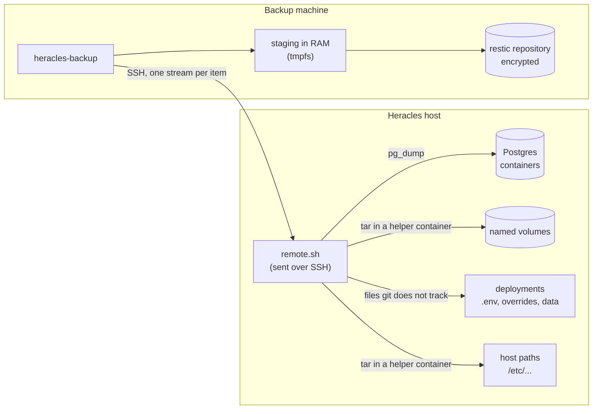

# heracles-backup

Backups for the Heracles host, the machine that runs the Heracles platform (reverse proxy, SSO, portal and the services hosted on it) with Docker Compose.

A backup machine pulls the host's data and secrets over SSH and stores them in an encrypted [restic](https://restic.net) repository. Code and images are not backed up: they come back from git and the registries. What is saved is everything they cannot give back: databases, volumes, `.env` files, local Compose overrides, keys and certificates.

```console
$ ./heracles-backup run
==> connecting to heracles
==> postgres: heracles-auth-postgresql-1
==> volume: app_data
==> path: /etc/openvpn/server
==> deployment files: heracles/heracles-proxy heracles/heracles-auth ...
==> saving the snapshot
==> forgetting old snapshots (keeping the last 10)
==> checking the repository
```

## Architecture



Each item is one SSH command whose standard output is a SQL dump or a tar archive. The backup machine stages them in RAM, saves them as one restic snapshot, forgets old snapshots and checks the repository.

## Design notes

- **Pull, never push.** The backup machine connects to the host, never the other way around. The host holds no credential for the backups, so a compromised host can neither read nor delete them.
- **Nothing installed on the host, nothing written to its disk.** `remote.sh` is sent over SSH on every run, so it is always in sync with this repository. Outputs are streamed, which matters on a host that runs on an SD card.
- **No sudo.** The SSH user only needs to be in the `docker` group. Root-owned files are read by a throwaway container that mounts them read-only. Membership in the `docker` group already gives root-level access, so this grants nothing new.
- **Databases are dumped, not copied.** Copying the files of a running Postgres can give a corrupt backup, so each database is exported with `pg_dump`. Containers holding SQLite databases are paused for the few seconds their files are archived.
- **Only what git cannot give back.** In each deployed repository, the files git does not track (untracked and ignored) are saved. That covers `.env` files, overrides, keys and data directories, and a service added later is covered without changing the tool. A directory that is not a git repository is saved whole. Build outputs can be excluded.
- **Secrets never touch a disk unencrypted.** Dumps are staged in `$XDG_RUNTIME_DIR` (RAM) and removed on exit, failure included. restic encrypts on the client side.
- **A failed run saves nothing.** Every item is fetched before restic runs. A missing volume or path is reported instead of being silently created by `docker run -v`.
- **Run by hand.** The tool is meant to be run every now and then from a machine that is not always on, so it first checks that the host is reachable and stops with a clear message otherwise.

## Requirements

- Backup machine: bash, OpenSSH, restic ≥ 0.16.
- Host: bash, git, Docker, and an SSH user in the `docker` group. The helper image (`debian:bookworm-slim` by default, it needs GNU tar) is pulled on first use.

## Setup

```sh
cp backup.conf.example backup.conf   # git-ignored
$EDITOR backup.conf                  # host, repository, what to back up
./heracles-backup init               # creates the repository and, if missing, its password file
```

`init` generates a random password into `RESTIC_PASSWORD_FILE`. **Keep a copy of it outside the backup machine** (in a password manager, for instance): without it the backups cannot be read.

## Configuration

`backup.conf` is a bash file. See `backup.conf.example` for a commented template.

| Variable | Meaning |
|---|---|
| `SSH_HOST` | SSH destination of the host (`user@address` or an alias from `~/.ssh/config`) |
| `SOURCE_NAME` | Host name recorded in the snapshots (default: `SSH_HOST`) |
| `RESTIC_REPOSITORY`, `RESTIC_PASSWORD_FILE` | restic repository and its password file |
| `POSTGRES` | Containers running the official postgres image, dumped with `pg_dump` |
| `VOLUMES` | Named volumes, archived whole |
| `HOST_PATHS` | Host paths outside the deployments, such as `/etc/openvpn/server` |
| `DEPLOY_ROOT` | Directory holding the deployments, relative to the remote home |
| `PROJECTS` | Deployments to scan, relative to `DEPLOY_ROOT` |
| `EXCLUDES` | Paths under `DEPLOY_ROOT` to leave out (build outputs) |
| `PAUSE` | Containers paused while the deployment files are archived |
| `HELPER_IMAGE` | Image used on the host to read volumes and root-owned files |
| `KEEP_LAST` | Snapshots kept after each run (default: 10) |
| `SSH_COMMAND` | SSH client, as a bash array (default: `(ssh)`) |

## Usage

```sh
./heracles-backup run                  # back up, forget old snapshots, check
./heracles-backup restic snapshots     # any restic command on the repository
./heracles-backup restic ls latest
./heracles-backup restore /tmp/restore # latest snapshot (or: restore DIR ID)
```

The files keep their original path in the snapshot: after a restore they are under `DIR/<staging path>/heracles-backup/data/`.

| File | Content |
|---|---|
| `postgres/<container>.sql` | Plain SQL dump, with `DROP ... IF EXISTS` before each object |
| `volumes/<volume>.tar` | Content of the volume |
| `paths/<path>.tar` | Content of a host path (`/` replaced with `_`) |
| `deployment.tar` | Files git does not track, relative to `DEPLOY_ROOT` |

## Restoring the host

On a freshly installed host, with Docker and the deployments cloned again from git. Archives keep owners and permissions: extract them as root with `-p` to get them back.

1. **Deployment files**, before starting anything:
   ```sh
   sudo tar -xpf deployment.tar -C ~/deployment
   ```
2. **Host paths**, for instance:
   ```sh
   sudo mkdir -p /etc/openvpn/server
   sudo tar -xpf paths/etc_openvpn_server.tar -C /etc/openvpn/server
   ```
3. **Volumes**, before the containers that use them start:
   ```sh
   docker volume create <volume>
   docker run --rm -i -v <volume>:/dst debian:bookworm-slim tar -xp -C /dst < volumes/<volume>.tar
   ```
4. **Databases**: start only the database service, then load the dump:
   ```sh
   docker compose up -d <db-service>
   docker exec -i <container> sh -c 'psql --username="$POSTGRES_USER" --dbname="${POSTGRES_DB:-$POSTGRES_USER}"' < postgres/<container>.sql
   ```
5. Start the remaining services, and check each one.

## Tests

```sh
tests/run.sh
```

An integration test on the local Docker: `tests/fake-ssh` stands in for SSH, and the test sets up a fake host (a git deployment, a directory that is not a repository, a root-owned host path, a Postgres container, a volume, a container to pause) and a real restic repository. It checks the contents of a restored snapshot, retention, and that a failed run saves nothing. Needs Docker, restic and python3. Lint with `shellcheck -x heracles-backup remote.sh tests/*`.

## License

[MIT](LICENSE)
